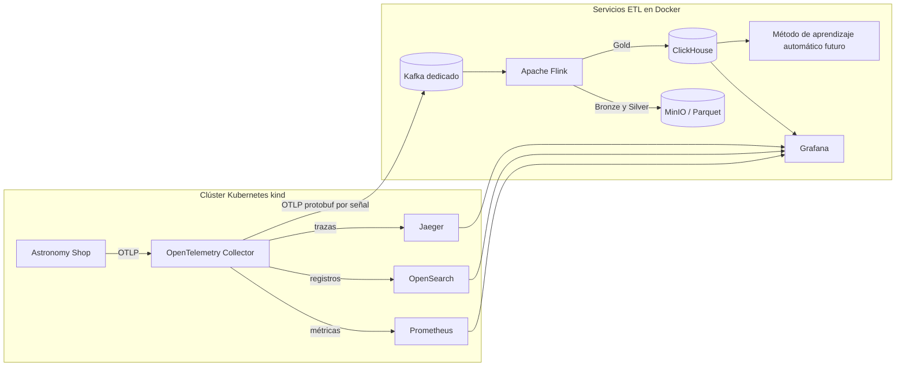
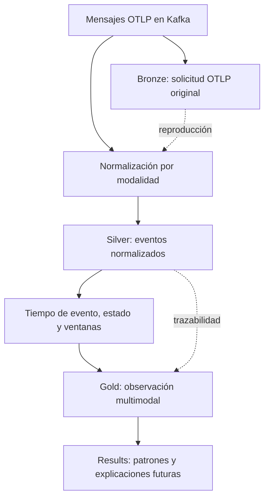
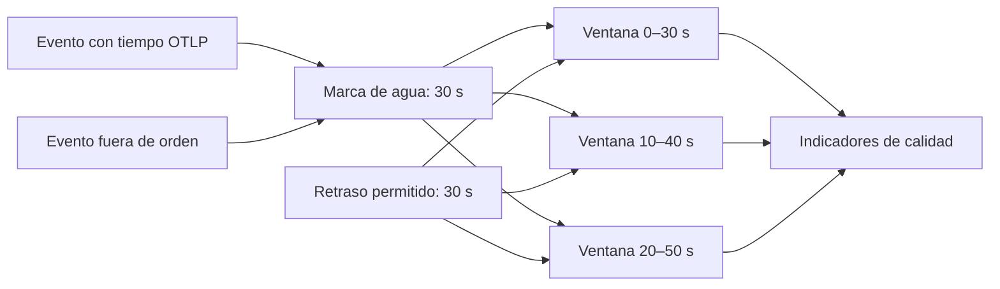
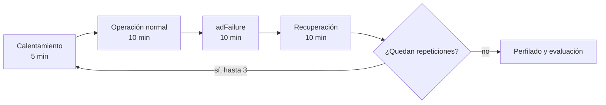
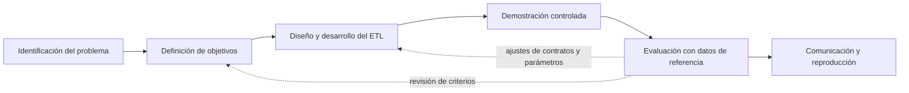

# Documentación académica del prototipo ETL multimodal local

## Resumen

Este documento sistematiza el prototipo de integración de telemetría
implementado en el repositorio `AIOpsLab`. El artefacto extiende la observación
por lotes con una canalización continua basada en OpenTelemetry Collector,
Apache Kafka, Apache Flink, MinIO, Parquet y ClickHouse. Su finalidad es
conservar la telemetría original y producir una representación conjunta de
métricas, registros y trazas por componente y ventana temporal, apta para la
exploración posterior de métodos de aprendizaje automático.

La implementación constituye un resultado de diseño y desarrollo, no la
selección definitiva de la arquitectura ni una validación experimental
concluida. La alternativa administrada con AWS Glue continúa vigente para la
comparación posterior. Asimismo, las características, ventanas, marcas de agua
y recursos configurados son hipótesis de ingeniería que deberán revisarse con
el perfil cuantitativo de la telemetría real.

Las figuras se codifican en Mermaid compatible con el renderizador nativo de
GitHub. De este modo, se presentan como gráficos en la vista web del repositorio
y su definición permanece versionable y auditable junto con el texto.

## 1. Fundamentación metodológica

La literatura multimodal reporta que el análisis conjunto puede aportar
información complementaria para tareas de detección, clasificación y
localización de fallos; sin embargo, los resultados disponibles proceden de
pocos sistemas y no son directamente comparables por sus diferencias de datos,
tareas y métodos [5]–[8]. Por ello, el prototipo no presupone que una técnica
particular reconocerá los patrones de interés ni que las tres señales siempre
estarán completas.

El diseño adopta una representación orientada a eventos como antecedente para
integrar señales heterogéneas. Kaiju muestra que métricas, registros y trazas
pueden tratarse mediante una tubería común sin eliminar el procesamiento
especializado de cada modalidad [11]. A su vez, la perspectiva *schema-first*
advierte que compartir nombres de campos no garantiza correspondencia
semántica: la correlación requiere tipos, unidades, recursos e identificadores
compatibles [16]. En consecuencia, el prototipo conserva los atributos OTLP,
explicita la procedencia y registra la ausencia de señales en vez de asumir una
unión perfecta.

AIOpsLab aporta el entorno controlado para desplegar microservicios, generar
carga, introducir condiciones conocidas y exportar telemetría [9]. En términos
de DSRM, la implementación corresponde principalmente a la actividad de diseño
y desarrollo del artefacto; su demostración y evaluación requieren todavía
ejecuciones completas, datos de referencia y criterios de aceptación [23].

## 2. Objetivo técnico y unidad de análisis

El objetivo técnico consiste en transformar solicitudes OTLP continuas en una
colección reproducible de observaciones multimodales. La unidad Gold se define
provisionalmente como:

```text
(run_id, window_start, window_end, service_name, service_namespace,
 k8s_namespace, pod_name, deployment_name)
```

Esta unidad representa el estado observable de un componente durante una
ventana. No se intenta unir cada punto métrico con cada registro y cada span en
una fila, porque esa operación produciría relaciones espurias y un crecimiento
combinatorio. En cambio, los enlaces directos se preservan en Silver y las
características se agregan en Gold mediante tiempo de evento y recursos
compartidos.

## 3. Arquitectura implementada



**Figura 1. Arquitectura física del prototipo local.** Elaboración propia.

El Collector conserva los destinos de observabilidad originales y añade una
rama secundaria hacia Kafka. Esta duplicación mantiene la capacidad de
inspeccionar las señales originales y desacopla el experimento de la
preparación multimodal. Kafka se despliega como instancia dedicada y no
reutiliza el broker funcional de Astronomy Shop, con el fin de evitar que una
sobrecarga o un reproceso del ETL afecte simultáneamente el sistema observado.

| Componente | Responsabilidad implementada | Frontera explícita |
|---|---|---|
| OpenTelemetry Collector | Recepción, procesamiento ligero y duplicación de OTLP | No fusiona las modalidades |
| Kafka dedicado | Búfer durable, aislamiento y reproducción por offsets | No interpreta la semántica OTLP |
| Flink | Preservación, normalización, tiempo de evento, estado y ventanas | No presenta los resultados |
| MinIO y Parquet | Archivo histórico de Bronze y Silver | No reemplaza la consulta interactiva |
| ClickHouse | Persistencia y consulta de Gold y datos experimentales | No recibe OTLP directamente |
| Grafana | Consulta y presentación | No adquiere, fusiona ni ejecuta el método |

## 4. Contratos y transformación de los datos



**Figura 2. Transformación y linaje entre las capas lógicas.** Elaboración
propia.

### 4.1 Adquisición y transporte

El Collector exporta cada modalidad mediante un exportador Kafka independiente
con codificación `otlp_proto`, cola de envío y reintentos. Los temas
implementados son:

| Modalidad o control | Tema | Particiones | Retención inicial |
|---|---|---:|---:|
| Métricas | `otlp.metrics.v1` | 3 | 72 horas |
| Registros | `otlp.logs.v1` | 3 | 72 horas |
| Trazas | `otlp.traces.v1` | 3 | 72 horas |
| Control experimental | `experiment.control.v1` | 3 | 72 horas |

El sufijo `v1` identifica la versión del contrato de transporte. Una
modificación incompatible deberá originar otro tema o una migración explícita,
en lugar de reinterpretar los mensajes ya conservados.

### 4.2 Bronze: preservación de la evidencia original

Bronze conserva el payload OTLP binario y añade señal, tema, partición, offset,
timestamp Kafka, tiempo de recepción e identidad experimental. Los archivos se
escriben en Parquet bajo `s3://aiopslab-bronze/otlp` y se particionan por señal,
fecha UTC y `run_id`.

Esta capa cumple dos funciones metodológicas. Primero, conserva una referencia
auditable de lo recibido, incluso cuando el normalizador encuentra un cambio de
esquema. Segundo, permite reconstruir Silver y Gold con transformaciones nuevas
sin repetir necesariamente la condición experimental. La reproducción no
garantiza por sí sola equivalencia si cambian versiones, configuraciones o
semántica; esos elementos deberán registrarse en el paquete de ejecución.

### 4.3 Silver: normalización específica por modalidad

Cada solicitud OTLP se expande a un evento por punto métrico, registro o span.
Los eventos comparten:

- un `event_id` determinista;
- tiempo del evento, tiempo observado y tiempo de recepción;
- tema, partición y offset de procedencia;
- `run_id`, escenario y condición;
- nombre del servicio y recursos Kubernetes;
- identificadores de traza y span cuando existen;
- atributos completos del evento y del recurso en JSON;
- indicadores de retraso, duplicación y error de esquema.

Las métricas conservan nombre y valor; los histogramas se reducen
provisionalmente a `sum / count` y los *summaries* producen un evento por
cuantil. Los registros conservan cuerpo, severidad e identificadores de traza y
generan una plantilla básica. Los spans conservan operación, jerarquía,
duración, estado y destino de dependencia cuando los atributos lo permiten. Una
solicitud no interpretable se registra en una tabla de cuarentena, mientras su
payload permanece disponible en Bronze.

### 4.4 Gold: representación conjunta por ventana

Gold utiliza una ventana deslizante inicial de 30 segundos con avance de 10
segundos. La unión es externa: si una modalidad no aparece, la observación no se
elimina y se activa el indicador `missing_metrics`, `missing_logs` o
`missing_traces`.

| Dimensión | Características implementadas |
|---|---|
| Métricas | número de puntos, media provisional de CPU y memoria |
| Registros | total, errores, conteos por severidad y plantilla |
| Trazas | spans, spans erróneos, duración p50/p95/p99 y dependencias |
| Conjuntas | tasa de solicitudes y tasa de errores |
| Calidad | modalidades ausentes, eventos tardíos, duplicados y errores de esquema |
| Referencia | condición, tipo de fallo y componente intervenido |

Las fórmulas actuales son explícitas, pero no definitivas:

```text
request_rate = span_count / window_seconds
error_rate   = (error_logs + error_spans) / (logs + spans)
```

La latencia procede de la duración de spans. CPU y memoria se seleccionan por
coincidencias en los nombres de métricas. Estas reglas permiten iniciar el
perfilado, pero deberán sustituirse o confirmarse con el inventario real, las
unidades y las convenciones semánticas observadas.

## 5. Modelo temporal, correlación y calidad



**Figura 3. Tratamiento inicial del tiempo de evento y de los datos tardíos.**
Elaboración propia.

Flink asigna el timestamp OTLP como tiempo de evento y emplea una marca de agua
con 30 segundos de desorden tolerado. Un evento se marca como tardío cuando la
diferencia entre recepción y tiempo de evento supera 30 segundos. Las ventanas
admiten 30 segundos adicionales de retraso. Estos valores deberán contrastarse
con el percentil 99 del retraso observado.

La correlación sigue una jerarquía:

1. `trace_id` y `span_id` preservan enlaces directos entre registros y trazas;
2. `service.name`, namespace y recursos Kubernetes identifican el componente;
3. el tiempo de evento ubica los datos en ventanas comparables;
4. las métricas se agregan por componente y no se fuerzan a una relación
   individual con cada span.

El `event_id` se deriva de tema, partición, offset e índice interno. Flink
mantiene durante seis horas un estado de eventos vistos. Una relectura se
conserva en Silver con la marca de duplicado, pero Gold la contabiliza como dato
de calidad y evita sumarla nuevamente a las características.

## 6. Datos de referencia y prevención de fuga

El tema de control experimental distribuye intervalos con `run_id`, escenario,
condición, tipo de fallo, componente afectado e inicio y fin. Flink mantiene
estos intervalos como estado *broadcast* y asocia cada mensaje Bronze con el
intervalo que contiene su timestamp Kafka.

ClickHouse conserva `condition`, `fault_type` y `affected_component` para la
evaluación. La vista `pattern_input` los excluye deliberadamente. Esta separación
impide que el método reciba como entrada la respuesta que posteriormente se
utilizará para juzgarlo. Las etiquetas constituyen datos de referencia para la
evaluación; no demuestran causalidad ni garantizan que la telemetría manifieste
el fallo de manera detectable.

## 7. Entrega, recuperación y reproducibilidad

| Tramo | Semántica implementada | Mecanismo |
|---|---|---|
| Collector → Kafka | reintentos con confirmación del broker | cola del exportador y `acks=1` |
| Kafka → estado Flink | consistencia con checkpoints | restauración conjunta de offsets y estado |
| Flink → Parquet | exactamente una vez respecto al checkpoint confirmado | cierre de archivos al completar checkpoint |
| Flink → ClickHouse | al menos una vez | lotes JDBC y reintentos |
| Consulta Gold | idempotencia lógica | `feature_id`, versión y `ReplacingMergeTree` |

La garantía extremo a extremo no se denomina exactamente una vez, porque el
sink JDBC puede repetir una escritura después de una recuperación. La vista
`gold_multimodal_latest` selecciona la versión vigente de cada vector. Los
checkpoints y *savepoints* se almacenan en MinIO, y los volúmenes de Kafka,
ClickHouse y MinIO se conservan al detener el entorno.

## 8. Protocolo de demostración y evaluación



**Figura 4. Secuencia del protocolo experimental inicial.** Elaboración propia.

Cada repetición registra versión de la aplicación, configuración, carga,
escenario, condición, intervalos, offsets y estado de ejecución. El ejecutor
modifica la bandera de fallo del servicio de anuncios y restaura la variante
original incluso ante una excepción. Una prueba con duración reducida verifica
la integración técnica, pero no sustituye las tres repeticiones completas.

El perfilador previsto mide:

- registros, eventos y bytes por modalidad;
- eventos y bytes por segundo;
- servicios, pods, métricas, operaciones y severidades;
- cobertura de `trace_id` y `span_id`;
- retraso, desorden, duplicados y errores de esquema;
- firmas de atributos para identificar variaciones de esquema;
- componentes presentes en una, dos o tres modalidades;
- cobertura multimodal de las observaciones Gold.

Estas mediciones deberán justificar la cantidad de particiones, el paralelismo,
la retención, los recursos, las ventanas y las marcas de agua. La aceptación no
se basará únicamente en que los contenedores estén activos.

## 9. Articulación con DSRM



**Figura 5. Ubicación del ETL dentro del ciclo iterativo de DSRM.** Elaboración
propia a partir de [23].

El código implementado constituye un producto verificable de diseño y
desarrollo. La demostración se completará cuando la ruta Collector–Kafka–Flink–
MinIO/ClickHouse opere con Astronomy Shop. La evaluación deberá comparar la
salida con los objetivos de integración y con los datos de referencia, y podrá
devolver el trabajo al diseño si la cobertura, el retraso o la correspondencia
semántica resultan insuficientes.

## 10. Estado verificable del artefacto

El registro A01–A07 de la [matriz de evidencia](../matriz_evidencia.md)
documenta la trazabilidad del estado técnico. Hasta el cierre de esta
documentación se verificó:

- configuración de tres exportadores Kafka sin sustituir los backends
  originales;
- clúster `kind` con dos nodos disponibles;
- Kafka 4.2.0 saludable, cuatro temas creados y conectividad desde Kubernetes;
- producción y consumo de un evento de control;
- compilación del trabajo Flink y dos pruebas Java aprobadas;
- tres pruebas del ejecutor experimental aprobadas;
- definición de los contratos Parquet, el esquema ClickHouse y las fuentes de
  Grafana.

La imagen `aiopslab/telemetry-etl:1.0.0` no terminó de construirse por
interrupciones DNS/TLS durante la descarga de la imagen base de Flink. Este hecho
no se interpreta como un defecto demostrado del trabajo Java. Tampoco se han
validado todavía el flujo OTLP completo, los archivos Parquet, las consultas
Gold ni el experimento de 105 minutos.

## 11. Limitaciones y decisiones pendientes

1. La implementación local es un artefacto para estudiar factibilidad y no
   cierra la comparación con AWS Glue.
2. La marca de agua, el tamaño y avance de ventana y el TTL de deduplicación no
   cuentan todavía con justificación empírica.
3. Los eventos que superan la tolerancia máxima no disponen de una salida
   lateral específica para analizar descartes extremos.
4. La selección de CPU y memoria depende de coincidencias nominales.
5. La tasa de solicitudes se aproxima mediante spans y no mediante la diferencia
   temporal de un contador monotónico.
6. La reducción de histogramas a una media pierde información distribucional;
   Bronze permite reconstruir otra representación.
7. La asociación de intervalos experimentales usa el timestamp Kafka y deberá
   compararse con el tiempo de evento cerca de las fronteras de fase.
8. El sink JDBC ofrece entrega al menos una vez e idempotencia en consulta, no
   una transacción distribuida exactamente una vez.
9. La técnica de aprendizaje automático y sus variables definitivas continúan
   pendientes de comparación empírica.
10. Los resultados solo podrán generalizarse a los sistemas, versiones, cargas,
    condiciones y periodos efectivamente evaluados.

## 12. Trazabilidad hacia la implementación

| Elemento | Ubicación en `../AIOpsLab` |
|---|---|
| Orquestación del ETL | `deploy/etl/docker-compose.yaml` |
| Exportadores del Collector | `aiopslab/observer/grafana/astronomy-shop-values.yaml` |
| Trabajo principal de Flink | `deploy/etl/flink-job/src/main/java/org/aiopslab/etl/TelemetryEtlJob.java` |
| Normalización OTLP | `deploy/etl/flink-job/src/main/java/org/aiopslab/etl/OtlpNormalizer.java` |
| Ventanas Gold | `deploy/etl/flink-job/src/main/java/org/aiopslab/etl/FeatureWindowFunction.java` |
| Esquema ClickHouse | `deploy/etl/clickhouse/init/001_schema.sql` |
| Protocolo experimental | `deploy/etl/experiment.py` |
| Perfil cuantitativo | `deploy/etl/profiling/profile.py` |
| Fuente y tablero Grafana | `deploy/grafana/provisioning/` y `deploy/grafana/dashboards/etl-multimodal.json` |
| Operación integral | `scripts/etl.sh` |

## 13. Referencias

[5] C. Lee, T. Yang, Z. Chen, Y. Su, and M. R. Lyu, “Eadro: An end-to-end troubleshooting framework for microservices on multi-source data,” in *Proc. 45th IEEE/ACM Int. Conf. Softw. Eng. (ICSE)*, 2023, pp. 1750–1762, doi: 10.1109/ICSE48619.2023.00150.

[6] S. Zhang et al., “Robust failure diagnosis of microservice system through multimodal data,” *IEEE Trans. Serv. Comput.*, vol. 16, no. 6, pp. 3851–3864, Nov.–Dec. 2023, doi: 10.1109/TSC.2023.3290018.

[7] C. Zhao et al., “Robust multimodal failure detection for microservice systems,” in *Proc. 29th ACM SIGKDD Conf. Knowl. Discov. Data Min. (KDD)*, 2023, pp. 5639–5649, doi: 10.1145/3580305.3599902.

[8] G. Yu, P. Chen, Y. Li, H. Chen, X. Li, and Z. Zheng, “Nezha: Interpretable fine-grained root causes analysis for microservices on multi-modal observability data,” in *Proc. 31st ACM Joint Eur. Softw. Eng. Conf. Symp. Found. Softw. Eng. (ESEC/FSE)*, 2023, pp. 553–565, doi: 10.1145/3611643.3616249.

[9] Y. Chen et al., “AIOpsLab: A holistic framework to evaluate AI agents for enabling autonomous clouds,” *Proc. Mach. Learn. Syst.*, vol. 7, 2025. [Online]. Available: https://proceedings.mlsys.org/paper_files/paper/2025/hash/d1f9e4a9f109b6e8b75ed362736f22ec-Abstract-Conference.html

[11] M. Scrocca, R. Tommasini, A. Margara, E. Della Valle, and S. Sakr, “The Kaiju project: Enabling event-driven observability,” in *Proc. 14th ACM Int. Conf. Distributed Event-Based Syst. (DEBS)*, 2020, pp. 85–96, doi: 10.1145/3401025.3401740.

[16] Y. Shkuro, B. Renard, and A. Singh, “Positional paper: Schema-first application telemetry,” *arXiv preprint arXiv:2206.11380*, Jun. 2022, doi: 10.48550/arXiv.2206.11380.

[23] K. Peffers, T. Tuunanen, M. A. Rothenberger, and S. Chatterjee, “A design science research methodology for information systems research,” *J. Manage. Inf. Syst.*, vol. 24, no. 3, pp. 45–77, 2007, doi: 10.2753/MIS0742-1222240302.
