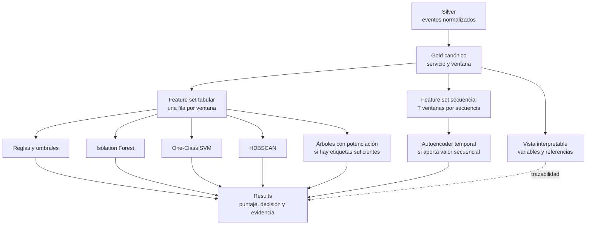
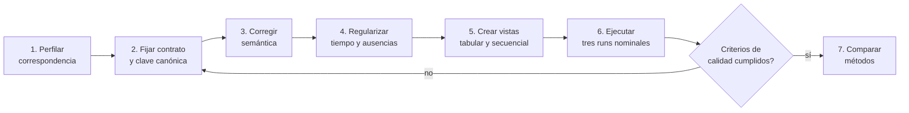

# Plan de mejora del Gold y protocolo de ejecuciones

## 1. Propósito y estado

Este documento especifica la siguiente iteración del ETL local implementado en
`AIOpsLab`. Su propósito es convertir el Gold experimental actual en una
representación multimodal con semántica suficientemente estable para comparar
métodos de reconocimiento de patrones. También define las ejecuciones necesarias
para verificar esa representación antes de entrenar modelos.

El contenido funciona como especificación de diseño y validación, no como una
selección anticipada del método. Los algoritmos candidatos continúan sujetos a
comparación empírica. La implementación base y sus limitaciones se describen en
[el informe del prototipo local](03_prototipo_local_implementado.md).

### 1.1 Estado de implementación al 10 de noviembre de 2026

La especificación se implementó en el repositorio `AIOpsLab` mediante
`gold_service_window_v2`, `feature_tabular_v1`, `feature_sequence_v1`,
`evaluation_reference_v1` y `pattern_results_v1`. Bronze y Silver v2 se
persisten en prefijos independientes para conservar la versión anterior; las
unidades de métricas, el tipo de instrumento y el tipo de span forman parte de
Silver. El despliegue aplica migraciones idempotentes, reinicia el Collector
después de recrear Kafka y verifica la ruta mediante crecimiento de offsets.

La revisión `gold_service_window_v2.2` limita la excepción TLS al receptor
`kubeletstats` local, utiliza `container.cpu.usage` en núcleos y
`container.memory.working_set` en bytes, y fija la clave en servicio y namespace
Kubernetes. Las identidades no resueltas permanecen auditables en Silver y no
se imputan en Gold. Estas reglas están implementadas y cubiertas por pruebas de
contrato, pero su cobertura y estabilidad todavía deben medirse en las tres
repeticiones nominales correctas. Antes de iniciarlas debe congelarse la cohorte
de namespaces: la
evaluación primaria utilizará `astronomy-shop`, mientras las señales que llegan
sin namespace se informarán por separado y no se fusionarán solo por compartir
`service.name`. La trazabilidad se registra como A08–A15 en la
[matriz de evidencia](../matriz_evidencia.md).

El perfil operativo usa RocksDB incremental,
intervalo de 60 segundos, pausa mínima de 30 segundos y concurrencia uno; además,
el ejecutor rechaza uso de disco igual o superior al 90 %, exige estabilidad del
plano de control y no permite que un fallo de restauración oculte el error
original. Estas salvaguardas forman parte del protocolo que deberá verificarse
con las tres repeticiones nominales. Los paquetes generados durante el
desarrollo permanecen locales, no se versionan y no se utilizan como resultados
experimentales.

## 2. Decisión central: un Gold canónico, no uno por algoritmo

La siguiente iteración mantendrá un Gold canónico independiente de los modelos.
Su unidad inicial será una observación multimodal de un servicio durante una
ventana de tiempo. A partir de ese contrato se derivarán conjuntos de
características adecuados para cada familia de métodos.

Esta separación distingue cuatro responsabilidades:

1. Gold representa qué se observó en el sistema.
2. Los *feature sets* determinan cómo se entrega esa observación a un método.
3. El componente de procesamiento ejecuta el algoritmo.
4. Results registra la salida, su explicación y su trazabilidad.



**Figura 1. Separación entre Gold, representaciones para modelado y resultados.**
Elaboración propia.

No se almacenarán en el Gold canónico campos que solo existen después de
aplicar un método, como `anomaly_score`, `cluster_id`, `reconstruction_error` o
`predicted_condition`. Tampoco se incorporarán valores escalados con estadísticas
del entrenamiento, porque esos parámetros pertenecen a una versión concreta del
preprocesamiento y pueden producir fuga de información.

## 3. Razones para revisar el Gold actual

La demostración técnica confirmó que el flujo puede formar ventanas Gold, pero
no estableció todavía que estas constituyan una matriz apta para aprendizaje
automático. Antes de comparar algoritmos deben resolverse los siguientes riesgos:

- la clave actual incorpora servicio, namespace, pod y deployment; una
  diferencia de metadatos entre modalidades puede separar en filas diferentes
  las métricas, los logs y las trazas del mismo servicio;
- `request_rate` aproxima actividad mediante todos los spans y no distingue
  solicitudes de servidor, spans cliente y operaciones internas;
- `error_rate` combina logs de error y spans de error en un solo cociente, lo
  que dificulta su interpretación y puede representar dos veces un mismo
  acontecimiento;
- CPU y memoria se seleccionan mediante coincidencias nominales sin validar de
  forma completa instrumento, tipo y unidad OTLP;
- los percentiles de latencia mezclan operaciones con semántica distinta;
- algunas características son redundantes y otras presentan cobertura baja;
- una bandera de ausencia puede significar que la señal no llegó o que llegó
  con otra identidad de recurso;
- las ventanas `mixed` cruzan fronteras experimentales y no deben incorporarse
  automáticamente al entrenamiento;
- el perfil preliminar incluyó el drenaje de mensajes acumulados, por lo que no
  permite fijar todavía el retraso estacionario ni la marca de agua definitiva.

Estos hallazgos no invalidan Bronze ni Silver. Ambas capas conservan los datos
necesarios para recalcular Gold sin repetir obligatoriamente la adquisición.

## 4. Contrato propuesto para `gold_service_window_v2`

La granularidad inicial será:

```text
run_id + window_start + window_end + service_name + k8s_namespace
```

El pod y el deployment se conservarán como contexto y cobertura, pero no
formarán parte de la clave inicial hasta demostrar que sus identificadores son
compatibles entre las tres modalidades. Una revisión posterior podrá definir un
Gold a nivel de workload o pod si las correspondencias medidas lo permiten.

### 4.1 Identidad, tiempo y procedencia

| Campo o grupo | Significado y requisito |
|---|---|
| `feature_id` | Identificador determinista de la versión del contrato, ejecución, servicio y ventana. |
| `run_id`, `scenario_id` | Identifican la unidad experimental; no son variables numéricas del modelo. |
| `window_start`, `window_end` | Intervalo UTC en tiempo de evento. |
| `service_name`, `service_namespace`, `k8s_namespace` | Identidad canónica del servicio y su contexto. |
| `pod_count`, `deployment_count` | Cobertura de recursos agregados, sin imponerlos como clave. |
| `gold_contract_version` | Versión de la semántica, granularidad y transformaciones. |
| referencias de origen | Particiones, offsets o identificadores que permitan llegar a Silver y Bronze. |

### 4.2 Variables de métricas y trazas

| Variable propuesta | Definición requerida |
|---|---|
| `request_rate` | Tasa derivada de spans de servidor o de una métrica HTTP explícita; la fuente debe quedar registrada. |
| `span_count` | Número de spans incluidos después de declarar tipos y filtros. |
| `span_error_ratio` | `error_span_count / span_count`, con tratamiento explícito cuando el denominador es cero. |
| `latency_p50_ms`, `latency_p95_ms`, `latency_p99_ms` | Percentiles sobre una población declarada, inicialmente spans de servidor, y con conteo de muestras. |
| `cpu_utilization` o `cpu_usage_cores` | Una de las dos semánticas, sin mezclarlas y conservando unidad OTLP. |
| `memory_working_set_bytes` | Uso de memoria seleccionado por instrumento y unidad, no solo por coincidencia textual. |
| `dependency_edge_count` | Cantidad de dependencias distintas con su cobertura de atributos. |

Las medias deberán acompañarse de conteos de muestras para permitir
agregaciones posteriores correctas. Los histogramas conservarán estadísticos
suficientes o se recalcularán desde Silver; no se combinarán percentiles ya
agregados como si fueran observaciones elementales.

### 4.3 Variables de logs

| Variable propuesta | Definición requerida |
|---|---|
| `log_count` | Cantidad de registros en la ventana. |
| `log_error_count` | Cantidad de registros con severidad ERROR o superior. |
| `log_error_ratio` | `log_error_count / log_count`, separado del error de spans. |
| `severity_counts` | Conteos por severidad con vocabulario normalizado. |
| `event_template_counts` | Conteos de plantillas versionadas y vinculables al mensaje original. |

Los mapas de severidades y plantillas pueden permanecer como estructuras
interpretables en Gold. Su conversión a columnas *top-k*, hashing o vectores se
realizará en un *feature set* versionado, no alterando su significado original.

### 4.4 Calidad y ausencia

Gold deberá distinguir entre ausencia real, falta de correspondencia y error de
procesamiento mediante, al menos:

- `missing_metrics`, `missing_logs` y `missing_traces`;
- `identity_mismatch_suspected`;
- `late_event_count`, `duplicate_event_count` y `schema_error_count`;
- conteos de muestras por grupo de características;
- `row_present`, cuando se construya una rejilla temporal completa;
- cobertura de `trace_id`, `span_id`, `service.name` y atributos Kubernetes;
- versión del normalizador y de la plantilla de logs.

Un valor numérico igual a cero no sustituirá una ausencia. Las variables que no
puedan calcularse se conservarán como nulas junto con sus indicadores de
calidad. La imputación será una operación posterior ajustada solo con datos de
entrenamiento.

## 5. Contratos derivados para los algoritmos

### 5.1 `feature_tabular_v1`

Contendrá una fila por observación de `gold_service_window_v2` y una selección
numérica común. Será el punto de partida para reglas, Isolation Forest,
One-Class SVM, HDBSCAN, árboles con potenciación y una línea base no temporal.

La selección inicial podrá incluir:

```text
request_rate
span_count
span_error_ratio
log_count
log_error_ratio
latency_p50_ms
latency_p95_ms
latency_p99_ms
cpu_utilization o cpu_usage_cores
memory_working_set_bytes
dependency_edge_count
missing_metrics
missing_logs
missing_traces
row_present
```

La vista no incluirá `condition`, `fault_type` ni `affected_component`. Tampoco
convertirá `run_id`, `service_name` o timestamps en magnitudes arbitrarias. Esos
campos servirán para agrupar, dividir y reconstruir la trazabilidad.

### 5.2 `feature_sequence_v1`

El conjunto secuencial se formará ordenando las mismas observaciones tabulares
por `run_id`, servicio y tiempo. Una muestra tendrá forma `T × F`, donde `T` es
la cantidad de pasos y `F` la cantidad de características. Con un avance de diez
segundos, una secuencia de dos minutos contiene doce pasos.

No se permitirá que una secuencia:

- cruce de un `run_id` a otro;
- mezcle servicios sin un mecanismo explícito de representación;
- atraviese discontinuidades temporales sin `row_present` y máscaras;
- combine entrenamiento y prueba;
- use `condition` o `fault_type` como características.

### 5.3 Etiquetas y resultados

Los datos de referencia para la evaluación permanecerán en un contrato separado:

```text
run_id
window_start
window_end
condition
fault_type
affected_component
label_assignment_basis
```

Los resultados usarán un contrato común:

```text
result_id
feature_id o sequence_id
model_name
model_version
feature_set_version
preprocessing_version
pattern_score
decision
threshold_version
explanation_json
inference_time_ms
created_at
```

Los campos específicos, como `cluster_id`, `membership_probability` o el error
de reconstrucción por variable, se agregarán como extensiones sin modificar el
Gold.

## 6. Cuándo se justificaría otro Gold

No se creará una tabla Gold diferente solo porque un algoritmo prefiera otro
formato. Una representación adicional se justificará únicamente si cambia la
unidad de análisis necesaria para responder una pregunta distinta, por ejemplo:

| Representación | Unidad de análisis | Posible necesidad |
|---|---|---|
| `gold_service_window_v2` | Servicio durante una ventana | Comparación inicial tabular y temporal. |
| `gold_trace_interaction` | Traza o cadena de operaciones | Estudiar patrones completos de una interacción distribuida. |
| `gold_event_sequence` | Secuencia ordenada de eventos | Conservar el orden fino que una ventana agregada elimina. |
| `gold_dependency_graph` | Grafo de servicios y llamadas | Evaluar una hipótesis relacional explícitamente justificada. |

La incorporación de una representación adicional requerirá declarar la
información que pierde el Gold inicial, la pregunta que no puede responderse y
una comparación reproducible que justifique el costo adicional.

## 7. Plan de implementación de la mejora



**Figura 2. Secuencia y retorno de la mejora del Gold.** Elaboración propia.

### Paso 1. Perfilar la correspondencia de identidades

Se medirá por modalidad y servicio la presencia y consistencia de
`service.name`, namespace, pod, deployment, `trace_id` y `span_id`. La salida
será una tabla de correspondencias y conflictos, no una corrección implícita.

### Paso 2. Versionar el contrato y la clave canónica

Se creará `gold_service_window_v2` sin reemplazar de inmediato el esquema
anterior. La versión previa se conservará para comparar conteos y detectar
pérdidas durante la migración.

### Paso 3. Corregir la semántica de las características

Se separarán errores por modalidad, se declarará la población de spans usada
para tasa y latencia, se validarán tipos y unidades de las métricas y se
eliminarán características duplicadas. Toda transformación conservará referencia
a los eventos Silver de origen.

### Paso 4. Regularizar tiempo y ausencias

Se construirá una rejilla por servicio con el avance seleccionado, incluyendo
pasos sin eventos. Se comprobarán con datos estacionarios el tamaño de ventana,
el avance, la marca de agua, la tolerancia de retraso y el tratamiento de
fronteras experimentales.

### Paso 5. Construir y probar los contratos derivados

Se crearán las vistas tabular y secuencial y se verificará que las etiquetas no
aparezcan entre las variables. Las transformaciones de `log1p`, imputación,
escalado o reducción dimensional quedarán parametrizadas y versionadas fuera de
Gold.

### Paso 6. Ejecutar la calibración experimental

Las tres repeticiones nominales medirán estabilidad, cobertura y retraso. Solo
después de satisfacer los criterios de la sección 9 se habilitará la comparación
de algoritmos.

**Estado vigente.** Los pasos 1–5 están implementados y cubiertos por pruebas
automatizadas. El paso siguiente es congelar en el
manifiesto la cohorte primaria `k8s_namespace = astronomy-shop` y ejecutar las
tres repeticiones nominales sin modificar versiones, carga ni contrato entre
ellas. Las filas sin namespace se conservarán como estrato de calidad separado.

## 8. Protocolo de runs

### 8.1 Precondiciones

Antes de cada repetición se registrará y verificará:

- versión de Astronomy Shop, AIOpsLab, ETL y contrato Gold;
- salud de Collector, Kafka, Flink, MinIO, ClickHouse y Grafana;
- trabajo Flink estable y checkpoints recientes sin fallos;
- offsets de Kafka y ausencia de un backlog no explicado;
- carga configurada y mantenida bajo el mismo perfil;
- reloj y zona horaria de los componentes;
- bandera `adFailure` en estado inicial `off`;
- espacio, CPU y memoria disponibles;
- ausencia de otra ejecución activa;
- `run_id` nuevo y manifiesto inmutable de configuración.

Si el consumidor no está al día, la ejecución se marcará como diagnóstica y no
se mezclará con las repeticiones nominales.

### 8.2 Secuencia nominal por repetición

| Fase | Duración | Condición conocida | Uso |
|---|---:|---|---|
| Calentamiento | 5 min | Sin condición introducida | Estabilizar aplicación, carga y flujo; se excluye del entrenamiento. |
| Referencia | 10 min | Operación normal | Caracterizar el comportamiento de referencia. |
| Condición | 10 min | `adFailure` activado | Observar la respuesta multimodal a una intervención conocida. |
| Recuperación | 10 min | `adFailure` retirado | Medir retorno, persistencia y retraso de los efectos. |

Cada repetición dura 35 minutos y el protocolo de tres repeticiones suma 105
minutos, sin contar verificaciones previas y posteriores. La carga, versiones y
configuración se mantendrán constantes, salvo que el objeto de una run se declare
explícitamente como una variación controlada.

### 8.3 Controles durante la ejecución

Se observarán sin modificar la condición experimental:

- tasa y bytes por modalidad;
- retraso en tiempo de evento y backlog de Kafka;
- checkpoints, reinicios y consumo de memoria de Flink;
- duplicados, eventos tardíos, errores de esquema y cuarentena;
- archivos Bronze/Silver y filas Gold creadas;
- cobertura trimodal e identidades no correspondidas;
- instante real de activación y retirada de la condición;
- latencia hasta la disponibilidad en ClickHouse.

### 8.4 Cierre de cada repetición

La bandera se restaurará a `off` incluso si falla la ejecución. Se esperará el
drenaje del flujo y tres conteos Gold no vacíos e iguales antes de generar el
perfil por `run_id`; después se comprobará la
conciliación entre Kafka, Bronze, Silver y Gold. El paquete de la run incluirá:

```text
manifest.json
configuration/
offsets-and-checkpoints.json
telemetry-profile.json
gold-quality-report.json
phase-timeline.json
logs/
checksums.txt
```

Una repetición interrumpida o contaminada se conservará con su estado y motivo;
no se renombrará ni sustituirá silenciosamente por otra.

## 9. Criterios para aceptar el Gold antes del modelado

Para las ejecuciones nominales se preespecifica como control inicial provisional
que la cobertura de CPU y memoria no sea inferior al 90 % de las ventanas con
métricas de los servicios del namespace objetivo. Este umbral, la cohorte
`astronomy-shop` y el tratamiento separado del namespace vacío permanecerán
constantes durante las tres repeticiones y solo se considerarán validados con
sus resultados. Los demás umbrales se fijarán con el informe comparativo antes
de comparar modelos. Como mínimo, las
tres repeticiones deberán demostrar:

1. correspondencia documentada de identidad entre las tres modalidades;
2. una sola fila por clave lógica y versión en la vista de consulta;
3. cobertura y ausencia cuantificadas por servicio y fase;
4. unidades y poblaciones declaradas para cada característica;
5. ausencia de etiquetas experimentales en los *feature sets*;
6. rejilla temporal regular y discontinuidades identificables;
7. retraso estacionario compatible con la marca de agua seleccionada;
8. conciliación explicable entre eventos de entrada y agregados Gold;
9. estabilidad de las distribuciones normales entre repeticiones o registro de
   la variación que impida considerarlas equivalentes;
10. trazabilidad de una observación Gold de muestra hasta Silver y Bronze;
11. ejecución sin reinicios no explicados, pérdidas silenciosas ni agotamiento de
    memoria;
12. informe de ventanas `mixed`, tardías y afectadas por fronteras de fase.

El incumplimiento no se resolverá alterando el conjunto de prueba. Deberá
atribuirse al contrato, los datos, el flujo, la instrumentación o las condiciones
experimentales y devolver el trabajo al paso correspondiente.

## 10. Runs posteriores para comparar métodos

Una vez aceptado Gold, se congelarán:

- versión de `gold_service_window_v2`;
- versión de los *feature sets*;
- cohorte de servicios y ventanas;
- manifiesto de particiones por `run_id`;
- variables disponibles para cada comparación primaria;
- métricas y reglas para seleccionar hiperparámetros;
- datos de referencia y umbrales de decisión.

Las divisiones se harán por ejecución completa, no por filas aleatorias, porque
las ventanas deslizantes se solapan. La imputación, el escalado y cualquier
reducción dimensional se ajustarán solo con el conjunto de entrenamiento.

La ruta comparativa será de complejidad creciente:

1. reglas y umbrales robustos como línea base transparente;
2. Isolation Forest y One-Class SVM sobre el conjunto tabular común;
3. HDBSCAN como exploración de regímenes, estabilidad y ruido, no como sustituto
   automático de los detectores;
4. árboles con potenciación si los datos de referencia permiten entrenamiento
   supervisado sin comprometer la evaluación;
5. autoencoder temporal solo si existe suficiente continuidad y si la pregunta
   secuencial no queda respondida por las líneas base.

Para las comparaciones primarias, los métodos compatibles recibirán el mismo
contenido informativo. Se permitirá que cada uno aplique el preprocesamiento que
su estructura exige, pero no que reciba modalidades o periodos adicionales sin
declararlo como un experimento diferente.

También se realizarán ablaciones controladas con métricas, logs, trazas y sus
combinaciones. Estas variantes se derivarán del mismo Gold y permitirán evaluar
si la integración trimodal aporta información frente a representaciones parciales.

## 11. Evaluación y trazabilidad de los resultados

Los algoritmos solo se compararán directamente cuando produzcan resultados para
la misma tarea. Los detectores binarios o por puntaje podrán evaluarse mediante
precisión, exhaustividad, F1, curvas de precisión-exhaustividad, retraso y falsas
alarmas. HDBSCAN requerirá estabilidad, pertenencia, proporción de ruido y
correspondencia con los escenarios. El autoencoder añadirá error de
reconstrucción por variable e intervalo.

Cada resultado deberá conservar:

- algoritmo, versión, semilla e hiperparámetros;
- versión de Gold, *feature set* y preprocesamiento;
- ejecuciones de entrenamiento, validación y prueba;
- puntuación, umbral, decisión e incertidumbre disponible;
- variables, eventos o ejemplos que respaldan la salida;
- vínculos hacia Gold, Silver y Bronze;
- latencia y recursos consumidos.

La selección final considerará conjuntamente desempeño, estabilidad,
interpretabilidad, costo y utilidad para la tarea. Una puntuación superior en una
sola métrica no será suficiente.

## 12. Productos verificables de la iteración

La iteración se considerará completa cuando existan:

1. diccionario y contrato versionado de `gold_service_window_v2`;
2. tabla de correspondencia de identidad entre modalidades;
3. pruebas unitarias de cálculo, unidades, ventanas y ausencias;
4. pruebas de integración y reconciliación por `run_id`;
5. contratos `feature_tabular_v1`, `feature_sequence_v1` y Results;
6. manifiesto de particiones sin fuga temporal;
7. tres paquetes de ejecución nominal completos;
8. informe comparativo de cobertura, retraso y estabilidad;
9. decisión documentada de avanzar al modelado o retornar al diseño;
10. materiales necesarios para reproducir las transformaciones y consultas.

Este cierre habilita la exploración de algoritmos; no implica que el Gold sea
universal ni que la alternativa local haya sido seleccionada definitivamente
frente a AWS Glue.

Al 10 de noviembre de 2026 existen los contratos v2.2, trece pruebas Java, diez
pruebas unitarias del ejecutor en Python, el empaquetado por `run_id`, el perfil
de correspondencias y los materiales de reproducción. Continúan pendientes las
tres ejecuciones nominales correctas, la verificación cuantitativa de unicidad,
cobertura, retraso y estabilidad, el informe comparativo, el manifiesto de
particiones para modelado y la decisión formal de avance o retorno.
