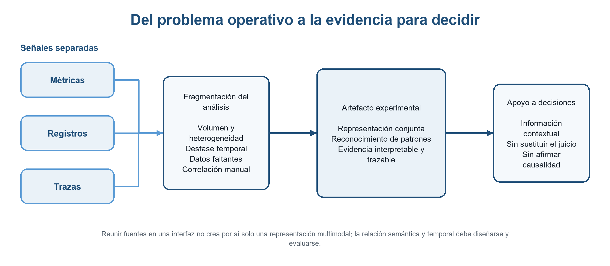
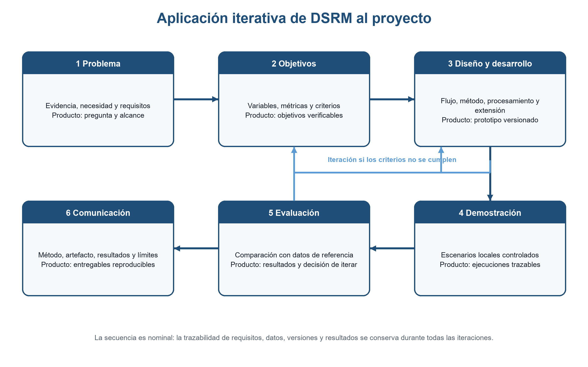

# Propuesta de investigación

**Proyecto:** Reconocimiento interpretable de patrones en la monitorización de sistemas distribuidos  
**Versión:** Ciclo 6 en desarrollo  
**Estado:** Borrador para la presentación de la propuesta

## Nota de alcance

El documento se sustenta en veinticuatro fuentes: veintidós antecedentes sobre observabilidad, análisis multimodal, interpretabilidad y evaluación, y dos referencias metodológicas incorporadas en este ciclo. El contexto disponible es internacional y técnico; no se presentan cifras específicas de Colombia. La propuesta se limita a un prototipo experimental validado en sistemas controlados desplegados localmente.

## 1 Planteamiento del problema

Los servicios digitales dependen de sistemas distribuidos cuyos componentes cooperan a través de redes, procesos y capas de infraestructura. La escala, la concurrencia y las dependencias entre servicios dificultan observar el estado global y localizar las condiciones asociadas con una degradación [1], [10]. Para examinar ese comportamiento se emplean métricas, que cuantifican recursos y desempeño; registros, que documentan acontecimientos; y trazas, que reconstruyen el recorrido de las solicitudes. Cada señal describe una parte distinta del sistema y ninguna ofrece por sí sola una visión suficiente.

El volumen de telemetría supera la capacidad de inspección manual, mientras las reglas y firmas predefinidas dependen de situaciones anticipadas [3], [20]. Los patrones de interés pueden expresarse como cambios de frecuencia, combinaciones de parámetros, secuencias, relaciones temporales o variaciones contextuales. Su reconocimiento se dificulta por el ruido, el desbalance, la falta de etiquetas, la pérdida de datos y la intercalación de eventos procedentes de procesos concurrentes [3].

El análisis conjunto tampoco se obtiene al reunir las fuentes en una misma vista. Métricas, registros y trazas difieren en formato, granularidad, frecuencia, volumen y significado. Relacionarlas exige definir cómo se adquieren, identifican, sincronizan, transforman y fusionan, además de tratar ausencias y desfases temporales [11], [16]–[19], [22]. La literatura reporta resultados favorables de métodos multimodales, pero las evaluaciones se concentran en pocos sistemas y emplean tareas, fallos y métricas distintas [5]–[8], [18], [19]. Por ello, sus resultados muestran viabilidad, no una solución generalizable a cualquier sistema distribuido.

Los profesionales también reportan saturación de datos y alertas, dificultades para correlacionar señales por falta de metadatos, vistas poco navegables y dependencia del conocimiento experto [15], [20]. Esto justifica la necesidad de una herramienta experimental que conecte la preparación multimodal, el reconocimiento de patrones y la presentación de evidencia dentro del flujo de monitorización. Su función no sería acumular paneles ni decidir por el operador, sino reducir la fragmentación de la información, conservar el vínculo entre cada resultado y sus datos de origen, y facilitar el examen de posibles relaciones relevantes para una decisión.

Esa herramienta requiere un método interpretable. Una explicación comprensible puede no ser fiel al criterio que produjo un resultado; por ello, la interpretabilidad debe evaluarse mediante correspondencia con los datos y acontecimientos relevantes, fidelidad, comprensibilidad y utilidad para la tarea [12], [13]. También deben distinguirse el reconocimiento de un patrón, la clasificación de una condición, la localización de un componente y la identificación de una posible causa, pues son capacidades diferentes y una correlación no demuestra causalidad [10], [14].

Si estas limitaciones persisten, cabe esperar que la monitorización continúe apoyándose en revisiones fragmentadas y que la verificación manual siga concentrando tiempo y conocimiento especializado. La investigación debe establecer si un método interpretable aplicado a las tres señales puede producir resultados trazables y útiles bajo condiciones controladas, sin anticipar una mejora ni generalizar más allá de los escenarios evaluados.

### Pregunta de investigación

¿De qué manera un método interpretable de reconocimiento de patrones en métricas, registros y trazas puede apoyar la toma de decisiones en la monitorización de sistemas distribuidos?

La figura 1 resume la relación entre las señales fragmentadas, la necesidad de una representación conjunta y el apoyo esperado a las decisiones. El artefacto propuesto organizará evidencia; no reemplazará el juicio del operador ni convertirá asociaciones en afirmaciones causales.

*Figura 1. Cadena conceptual del problema y la contribución propuesta. Elaboración propia.*

## 2 Objetivos

### Objetivo general

Apoyar las decisiones en la monitorización de sistemas distribuidos mediante un método de reconocimiento de patrones a partir de datos multimodales.

### Objetivos específicos

1. Diseñar un flujo de datos de observabilidad para sistemas distribuidos que integre métricas, registros y trazas en una representación conjunta apta para el análisis.

2. Explorar un método de aprendizaje automático para reconocer patrones en la representación conjunta de los datos de observabilidad de sistemas distribuidos e integrarlo en una extensión para una herramienta de observabilidad que presente los patrones identificados como información de apoyo a la toma de decisiones.

3. Validar la extensión diseñada mediante pruebas con agentes de evaluación sobre sistemas controlados desplegados localmente, valorando el desempeño del método y la utilidad de los resultados para la toma de decisiones.

## 3 Alcances y limitaciones

El proyecto llegará hasta un prototipo funcional experimental compuesto por un flujo de datos multimodal, un método interpretable de aprendizaje automático, un componente de procesamiento y una extensión para Grafana. El flujo abarcará adquisición, identificadores compartidos, sincronización temporal, transformaciones por modalidad, fusión y tratamiento de datos faltantes. El prototipo presentará los patrones y la evidencia asociada sin atribuir a Grafana la recolección, el almacenamiento, la unificación semántica o la ejecución del método.

La investigación estudiará conjuntamente métricas, registros y trazas. La técnica de aprendizaje automático, las variables de entrada y la representación final se seleccionarán durante el desarrollo; no se presupone aprendizaje profundo, grafos, Transformers, modelos de lenguaje ni otra arquitectura. Las capacidades de detección, clasificación, priorización o localización solo se incorporarán si la definición de patrón y los resultados experimentales las sustentan.

La validación se restringirá a sistemas controlados desplegados localmente, configuraciones reproducibles, condiciones conocidas y ventanas temporales documentadas. Los resultados no se generalizarán a todos los sistemas distribuidos. No se incluye despliegue industrial, operación continua, alta disponibilidad, remediación automática, certificación de seguridad ni demostración definitiva de causalidad. Los agentes de evaluación ejecutarán tareas previamente definidas; no constituyen una población humana ni sustituyen un estudio de usabilidad, aceptación o impacto organizacional con operadores.

## 4 Justificación

La monitorización de sistemas distribuidos produce señales complementarias, pero su volumen y heterogeneidad dificultan relacionarlas durante el análisis. Los estudios con profesionales reportan saturación de información, correlación limitada por metadatos insuficientes y dependencia del conocimiento experto [15], [20]. A su vez, la evidencia técnica muestra que la integración multimodal requiere semántica, identificadores, sincronización y transformaciones explícitas [11], [16]–[19]. Estas condiciones sustentan la necesidad de investigar un artefacto que conecte la preparación de datos, el reconocimiento de patrones y la presentación de evidencia trazable.

La contribución científica será un método interpretable de aprendizaje automático aplicado a una representación conjunta de métricas, registros y trazas. La investigación no fijará de antemano una familia de modelos; comparará alternativas según la definición de patrón, los datos disponibles, el desempeño y los criterios de interpretabilidad. Esta decisión evita confundir una salida visual o una explicación posterior con evidencia fiel y útil [12], [13].

La contribución tecnológica será un prototipo experimental que integre el método en una extensión para Grafana, manteniendo separadas las responsabilidades de las fuentes, el flujo de datos, el componente de procesamiento y la interfaz. Su valor práctico se examinará mediante tareas de decisión delimitadas, no mediante la promesa de automatizar el diagnóstico. La validación reproducible en sistemas locales permitirá contrastar integración, desempeño, interpretabilidad y utilidad con datos de referencia explícitos [9], [14], [21]. El resultado aportará un método, un flujo y evidencia experimental documentada, con límites claros para orientar trabajos posteriores y evitar generalizaciones no sustentadas.

## 5 Marco teórico

### Observabilidad de sistemas distribuidos

La monitorización comprueba condiciones conocidas mediante indicadores, umbrales y alertas. La observabilidad amplía ese propósito al permitir inferir el estado interno de un sistema a partir de las señales que produce [1], [15]. En sistemas distribuidos, esta inferencia es incompleta porque los componentes cambian, operan de forma concurrente y exponen datos con distinto nivel de detalle. La observabilidad no equivale a disponer de más paneles: requiere relacionar la evidencia con el contexto operacional y con la tarea que motiva el análisis.

El análisis asistido por aprendizaje automático busca organizar grandes volúmenes de telemetría y apoyar tareas operativas [1], [2]. Sin embargo, los resultados dependen de la calidad de las señales y de las decisiones de preparación. El proyecto adopta la observabilidad como base para examinar patrones, no como garantía de conocimiento completo sobre el sistema.

### Dependencias y propagación

Una solicitud puede atravesar varios servicios, instancias y recursos. Por esta razón, una degradación observada en un punto puede aparecer asociada con cambios posteriores en otros componentes. La arquitectura y las relaciones temporales ofrecen contexto para reconstruir esa propagación [4], [10], pero no prueban por sí solas una causa.

Los grafos de dependencias son una alternativa documentada para modelar componentes e interacciones [4]–[8]. También pueden emplearse representaciones tabulares, temporales, orientadas a eventos o híbridas. La elección debe corresponder a los datos, la definición de patrón y la capacidad de rastrear cada resultado; una estructura topológica no será un requisito previo.

### Señales multimodales

Las métricas resumen cantidades como utilización, latencia o tasa de errores. Los registros describen acontecimientos mediante mensajes estructurados o semiestructurados. Las trazas representan operaciones enlazadas a lo largo del recorrido de una solicitud. Estas señales ofrecen perspectivas complementarias sobre tendencias, eventos e interacciones [1].

Diversos estudios integran las tres modalidades para detectar, clasificar o localizar condiciones de interés [5]–[8], [18], [19]. Sus resultados respaldan la viabilidad del análisis conjunto, aunque no son directamente comparables porque cambian los sistemas, las etiquetas, los tipos de fallo y las métricas. En esta propuesta las tres señales forman el núcleo del método y ninguna se considera una ampliación opcional.

### Representación conjunta

Una representación conjunta exige más que consultar varias fuentes. El flujo debe establecer identificadores compartidos, correspondencia semántica, unidades, ventanas de correlación, transformaciones y criterios para datos ausentes [11], [16]. También debe conservar la proveniencia para reconstruir qué observaciones participaron en un patrón.

La literatura presenta estrategias basadas en eventos, identificadores de traza, dependencias temporales y mecanismos de fusión [11], [17]–[19]. Un conjunto de datos real muestra, además, que la ausencia de trazas completas limita el análisis trimodal aunque existan registros y métricas a gran escala [22]. Por tanto, la representación será una decisión experimental documentada y evaluada por su cobertura, consistencia y utilidad para el método.

### Aprendizaje automático y reconocimiento de patrones

Las reglas y los umbrales son comprensibles, cuentan con soporte operativo y siguen siendo frecuentes [20]. Su cobertura depende, sin embargo, de condiciones y relaciones previstas. El aprendizaje automático permite inferir regularidades supervisadas o no supervisadas a partir de los datos, pero ninguna técnica es adecuada para todos los escenarios [3], [5]–[8], [17]–[19].

Un patrón puede ser una frecuencia, una secuencia, una combinación de valores, una relación temporal o un comportamiento contextual. La investigación deberá operacionalizar qué patrón busca, qué unidad analiza y qué salida produce antes de seleccionar el modelo. Se compararán alternativas acordes con los datos y los recursos, sin asumir que una arquitectura más compleja tendrá mejor desempeño o interpretabilidad.

### Calidad y cambio de los datos

La telemetría puede contener ruido, duplicados, pérdidas, formatos variables, relojes desalineados y eventos intercalados [3], [16], [22]. La escasez de etiquetas y el desbalance dificultan la evaluación porque los casos de interés suelen ser menos frecuentes y su clasificación exige conocimiento del dominio. Estas condiciones pueden generar asociaciones espurias o esconder relaciones pertinentes.

Las versiones, configuraciones, cargas e infraestructuras cambian con el tiempo, lo que puede reducir la vigencia de una representación o de un modelo [1]–[3]. El proyecto no promete adaptación continua. Registrará versiones, condiciones de captura y transformaciones para limitar cada conclusión a las ventanas y escenarios evaluados.

### Interpretabilidad y evidencia

Una puntuación o visualización no basta para considerar interpretable un método. La literatura distingue la anomalía esperada por el usuario, el criterio del detector y la explicación generada; una explicación comprensible puede ser infiel al modelo [12]. También separa la atribución producida por un algoritmo de la interpretación que realiza una persona al relacionarla con una condición y una decisión [13].

La propuesta evaluará la evidencia mediante fidelidad, correspondencia con variables o acontecimientos relevantes, comprensibilidad y utilidad para la tarea. Cuando existan referencias adecuadas podrá medirse el error de atribución [13]. La evidencia describirá asociaciones y contribuciones observadas, sin convertirlas automáticamente en afirmaciones causales.

### Apoyo a la toma de decisiones

Detectar una desviación, clasificarla, localizar un componente y proponer una posible causa son tareas distintas [5]–[8], [10]. El apoyo a la decisión consiste en presentar información pertinente y trazable para una tarea definida, no en sustituir el juicio del operador. La priorización o localización solo será válida en la granularidad respaldada por los datos de referencia.

Los estudios industriales reportan saturación de alertas y dependencia del conocimiento experto [15], [20]. Los marcos de evaluación operativa separan tarea, resultado y tiempo [14]. En el proyecto, la utilidad se examinará con agentes de evaluación que ejecuten tareas reproducibles; este procedimiento no permitirá inferir aceptación humana ni impacto organizacional.

### Integración del prototipo

La arquitectura del prototipo separará cuatro responsabilidades. Las fuentes producirán o almacenarán la telemetría; el flujo preparará y relacionará las señales; el componente de procesamiento ejecutará el método; y la extensión presentará los patrones con su contexto y evidencia. Esta separación evita atribuir a la interfaz una integración semántica que depende de decisiones previas [11], [16].

Grafana será la plataforma de la extensión, no el método ni el repositorio de datos. La interfaz conservará vínculos hacia las observaciones de origen y expondrá únicamente capacidades respaldadas por la evaluación. No realizará remediación automática ni ocultará las incertidumbres y limitaciones del resultado.

### Validación reproducible

La validación de un artefacto multimodal requiere documentar el sistema, la carga, la instrumentación, las condiciones introducidas, las ventanas temporales y las transformaciones [9], [14], [21]. Los bancos existentes aportan escenarios, casos y líneas base, pero no sustituyen la definición de las variables específicas del proyecto.

Los datos de referencia para la evaluación, denominados también oráculo de evaluación en experimentación de software, son el conjunto explícito de etiquetas, condiciones conocidas, componentes intervenidos, secuencias esperadas o criterios de aceptación contra el que se comparan los resultados. No son un agente ni una herramienta. Los agentes ejecutan tareas; los datos de referencia permiten juzgar sus respuestas y las salidas del prototipo. La validación distinguirá integración multimodal, desempeño, interpretabilidad y utilidad, y limitará las conclusiones a los escenarios observados.

## 6 Metodología propuesta

### Enfoque y selección metodológica

La investigación será aplicada y se desarrollará bajo el paradigma de ciencia del diseño. El resultado esperado no es únicamente un modelo de aprendizaje automático, sino un artefacto compuesto por el flujo multimodal, el método de reconocimiento de patrones, el componente de procesamiento y la extensión de interfaz. Por esta razón se adopta Design Science Research Methodology (DSRM) como única metodología general. DSRM articula seis actividades: identificación del problema, definición de objetivos, diseño y desarrollo, demostración, evaluación y comunicación [23].

El punto de entrada será centrado en el problema: la investigación parte de las dificultades documentadas para relacionar métricas, registros y trazas y convertirlas en evidencia útil. La secuencia será nominal y no rígidamente lineal. Los hallazgos de la demostración o la evaluación podrán devolver el trabajo a la definición de objetivos o al diseño y desarrollo. Cada iteración conservará la relación entre requisitos, decisiones, versiones, datos y resultados [23].

CRISP-ML(Q) estructura el desarrollo y el aseguramiento de calidad de aplicaciones de aprendizaje automático [24], mientras MLOps aborda capacidades de ingeniería y operación a lo largo del ciclo de vida [2]. No se adoptan como metodologías adicionales porque el proyecto debe estudiar el artefacto completo y no llegará a una operación industrial continua. Sus prácticas podrán emplearse como apoyo técnico dentro del diseño y desarrollo, sin alterar la elección metodológica.

*Figura 2. Aplicación iterativa de DSRM en la propuesta. Elaboración propia a partir de [23].*

### Aplicación detallada de DSRM

#### 1 Identificación y motivación del problema

La identificación y motivación partirá del corpus bibliográfico, la matriz de evidencia, la caracterización inicial de los sistemas distribuidos y las restricciones del entorno local. Con estos elementos se establecerá qué problema se investigará, por qué requiere un artefacto y cuáles son sus límites, diferenciando los hallazgos reportados por la literatura de las inferencias formuladas para el proyecto. La evidencia se organizará alrededor de cuatro dificultades: fragmentación de métricas, registros y trazas; heterogeneidad semántica y temporal; carga de correlación manual; y falta de resultados trazables para una tarea de decisión.

Este análisis permitirá precisar el contexto de uso, las tareas que se pretende apoyar y las capacidades que quedan fuera, como la remediación automática o la demostración causal. También se revisará la pregunta de investigación para asegurar que no anticipe una mejora antes de la validación. Como resultado quedarán delimitados el problema, la pregunta, el mapa de actores técnicos y un inventario inicial de necesidades y restricciones. Se continuará a la siguiente fase cuando cada necesidad esté respaldada por evidencia o identificada explícitamente como decisión de diseño, y cuando la formulación del problema no dependa de una herramienta o técnica concreta.

#### 2 Definición de los objetivos de la solución

Con el problema delimitado, las necesidades se traducirán en objetivos verificables para el artefacto a partir del objetivo general, los tres objetivos específicos y las cuatro variables de delimitación: integración multimodal, desempeño del reconocimiento, interpretabilidad y utilidad para apoyar decisiones. Para ello se operacionalizará qué se entenderá por patrón, unidad de análisis, representación conjunta, resultado interpretable, tarea de decisión y agente de evaluación. En la integración se definirán criterios de cobertura, correspondencia semántica, alineación temporal, tratamiento de ausencias y proveniencia. Las métricas del método se escogerán después de precisar la tarea, sin imponer de antemano detección, clasificación, agrupamiento o localización. La interpretabilidad se expresará mediante criterios de fidelidad, correspondencia con eventos relevantes, complejidad de la evidencia y error de atribución cuando sea aplicable; la utilidad, mediante tareas, respuestas aceptables, exactitud, cumplimiento y tiempo de ejecución de los agentes.

La fase concluirá con una especificación de objetivos y criterios de aceptación que relacione cada objetivo con una medida, un dato de referencia y una prueba. Solo se avanzará al diseño cuando los criterios puedan observarse con los datos y recursos previstos y cuando la evaluación con agentes no se presente como evidencia de aceptación humana.

#### 3 Diseño y desarrollo

A partir de la especificación anterior, del sistema controlado seleccionado, de las fuentes de telemetría disponibles y de las restricciones de cómputo y reproducibilidad, se definirá la arquitectura del artefacto y se construirá una implementación experimental. El diseño precisará las fuentes de métricas, registros y trazas, los esquemas de cada modalidad, los identificadores compartidos, las unidades, los relojes y las ventanas de correlación. El flujo comprenderá adquisición, control de calidad, normalización, sincronización, transformación, fusión y tratamiento de datos faltantes, y cada observación conservará la proveniencia necesaria para reconstruir qué datos participaron en un resultado.

Sobre la representación conjunta se construirán líneas base y se explorarán técnicas de aprendizaje automático compatibles con la definición de patrón, el volumen de datos y los criterios de interpretabilidad. Cuando la técnica lo requiera, los datos se separarán por escenarios o periodos para ajuste, selección y evaluación, evitando que observaciones relacionadas aparezcan en conjuntos que produzcan fuga de información. La alternativa se seleccionará mediante evidencia comparativa y no por una preferencia previa por determinada arquitectura.

El método se implementará en un componente de procesamiento con entradas y salidas versionadas. La extensión para Grafana consultará esos resultados y presentará el patrón, su contexto, la evidencia asociada, la incertidumbre y los vínculos hacia los datos de origen, sin atribuir a la interfaz la recolección, el almacenamiento o la unificación semántica de la telemetría. Esta fase producirá un prototipo funcional versionado, acompañado por esquemas, contratos de datos, configuración, pruebas de componentes y registro de decisiones; se considerará listo para demostración cuando una ejecución controlada recorra el flujo completo y genere un resultado rastreable desde la interfaz hasta las observaciones de origen.

#### 4 Demostración

Una vez disponible el prototipo, la demostración comprobará que puede utilizarse de extremo a extremo en instancias concretas del problema, sin pretender todavía establecer su efectividad general. Para ello se emplearán el sistema distribuido desplegado localmente, las cargas y configuraciones documentadas y un catálogo de condiciones de interés. Se construirá una matriz de escenarios que incluya tanto comportamiento de referencia como condiciones conocidas introducidas de forma controlada, y para cada caso se registrarán la versión del sistema, la topología, la carga, la configuración, el momento de inicio y finalización, la condición aplicada y la ventana de observación.

En cada escenario se ejecutarán el flujo, el método y la extensión, verificando la llegada de las tres modalidades, la formación de la representación conjunta, la generación del patrón y la presentación de evidencia. Las repeticiones utilizarán parámetros y semillas registradas cuando correspondan. Cada ejecución generará un paquete trazable con la telemetría, las transformaciones, la salida del método, la evidencia mostrada y la bitácora. La fase podrá pasar a evaluación cuando existan ejecuciones completas y repetibles de los escenarios seleccionados, incluidas observaciones de referencia y al menos una condición de interés, sin interpretar este resultado como prueba de utilidad.

#### 5 Evaluación

Con los paquetes obtenidos durante la demostración, las líneas base, los datos de referencia para la evaluación y las reglas de comparación, se medirá en qué grado los resultados observados cumplen los objetivos definidos en la segunda fase. Los datos de referencia —también denominados oráculo de evaluación— indicarán qué condición ocurrió, dónde y cuándo, qué observaciones se esperan y qué respuestas se consideran aceptables.

| Dimensión | Qué se observará | Evidencia y métricas candidatas |
|---|---|---|
| Integración multimodal | Cobertura de las tres señales, correspondencia semántica, alineación temporal, ausencias y proveniencia | Porcentaje de eventos enlazados, desfase temporal, datos faltantes y trazabilidad completa |
| Desempeño | Capacidad para reconocer el patrón definido y costo de la inferencia | Métricas acordes con la tarea, comparación con líneas base, latencia y consumo de recursos |
| Interpretabilidad | Correspondencia y fidelidad de la evidencia respecto del resultado | Fidelidad, error de atribución cuando aplique, complejidad y vínculo con eventos relevantes |
| Utilidad | Apoyo proporcionado a tareas de decisión ejecutadas por agentes | Cumplimiento, exactitud, tiempo, consistencia y concordancia con respuestas de referencia |

El mismo protocolo se aplicará al método propuesto y a las líneas base pertinentes. Los resultados se resumirán por escenario y repetición mediante estadísticas descriptivas y medidas de variabilidad, mientras que los errores se examinarán por modalidad, transformación, tipo de condición y etapa del flujo. La reproducibilidad se controlará verificando que cada ejecución pueda reconstruirse a partir de las versiones, configuraciones, semillas y datos conservados.

Cuando un criterio no se cumpla, se determinará si la causa corresponde a un objetivo no observable, a los datos, al flujo, al método, a la integración o a la presentación. Los problemas de definición conducirán de nuevo a la segunda fase y las fallas del artefacto, a la tercera, de modo que los ajustes se incorporen antes de repetir la demostración y la evaluación. Si los criterios se satisfacen, se continuará con la comunicación. En todos los casos, la evaluación con agentes se interpretará dentro de su alcance y no permitirá inferir usabilidad, aceptación o impacto organizacional en operadores humanos.

#### 6 Comunicación

Tras la evaluación, la comunicación hará auditables el problema, el artefacto, la contribución y sus límites para audiencias académicas y técnicas. Para ello utilizará la trazabilidad acumulada durante todo el proceso y no únicamente los resultados favorables. Se documentarán la arquitectura, los esquemas y diccionarios de datos, las transformaciones, el método seleccionado y sus alternativas, las versiones, el protocolo experimental, las métricas, los resultados, los errores y las amenazas a la validez.

Esta documentación se complementará con instrucciones de reproducción, una demostración del prototipo y una explicación de la frontera entre las fuentes, el flujo, el componente de procesamiento y la interfaz. Los productos serán la propuesta, el informe de investigación, los materiales técnicos reproducibles y la presentación del prototipo. El ciclo se considerará cerrado cuando un tercero pueda relacionar la pregunta con los objetivos, el diseño, las pruebas, los datos de referencia, los resultados y las limitaciones sin depender de decisiones no documentadas.

### Unidades de análisis y control experimental

Las unidades de análisis serán las observaciones multimodales asociadas con un componente o interacción del sistema durante una ventana temporal definida. La unidad experimental será la combinación de sistema, versión, configuración, carga, escenario, condición y repetición. Los agentes de evaluación serán ejecutores instrumentados de tareas, no sujetos humanos ni datos de población.

Cuando la técnica seleccionada requiera ajuste, se separarán los datos usados para construir, seleccionar y evaluar el método. La división respetará la dependencia temporal y la pertenencia a un escenario para reducir fugas de información. Todas las ejecuciones registrarán versión del sistema, configuración, carga, semillas, transformaciones, versión del flujo y versión del modelo. Las conclusiones se limitarán a los escenarios, datos y ventanas observados.

### Controles de validez

La validez de constructo se atenderá mediante definiciones operativas y criterios vinculados a cada objetivo. La validez interna se protegerá documentando cargas, condiciones introducidas, cambios de configuración y posibles factores concurrentes. La validez de conclusión se apoyará en repeticiones, líneas base y reporte de variabilidad. La validez externa permanecerá limitada a los sistemas controlados desplegados localmente; la investigación no afirmará generalización a cualquier sistema distribuido. Si la telemetría contiene secretos, identificadores personales u otros datos sensibles, estos se excluirán o anonimizarán antes del análisis y de la comunicación de resultados.

## 7 Plan de trabajo

El plan sigue las actividades de DSRM y mantiene una secuencia de dependencias. Las iteraciones podrán devolver el trabajo a una etapa anterior cuando la demostración o la evaluación evidencien que un requisito no se cumple.

| Etapa | Actividades principales | Resultado esperado |
|---|---|---|
| 1 Delimitación | Actualizar el corpus, consolidar requisitos, reformular la pregunta y precisar patrón, interpretabilidad, utilidad y agente de evaluación | Problema, pregunta, objetivos y criterios de éxito aprobados |
| 2 Diseño experimental | Seleccionar el sistema local, definir cargas y condiciones de interés, establecer instrumentación, ventanas y datos de referencia | Protocolo experimental reproducible |
| 3 Flujo multimodal | Definir fuentes, esquemas, identificadores, sincronización, transformaciones, fusión, manejo de ausencias y proveniencia | Flujo implementado y conjunto multimodal versionado |
| 4 Exploración del método | Preparar líneas base, seleccionar variables, comparar técnicas de aprendizaje y evaluar alternativas de interpretabilidad | Método seleccionado con justificación experimental |
| 5 Desarrollo del prototipo | Implementar el componente de procesamiento, contratos de consulta, trazabilidad y extensión para Grafana | Prototipo funcional integrado |
| 6 Demostración | Ejecutar escenarios controlados, verificar el flujo completo y registrar resultados y fallos de integración | Evidencia de funcionamiento de extremo a extremo |
| 7 Validación | Ejecutar pruebas con agentes, comparar con los datos de referencia y valorar integración, desempeño, interpretabilidad y utilidad | Resultados, análisis de errores y límites de validez |
| 8 Comunicación | Consolidar documentación, materiales de reproducción, informe final y presentación del prototipo | Entregables académicos y técnicos del proyecto |

## Referencias

[1] L. Zhang et al., “A survey of AIOps in the era of large language models,” arXiv preprint arXiv:2507.12472, Jul. 2025, doi: 10.48550/arXiv.2507.12472.

[2] J. Diaz-de-Arcaya, A. I. Torre-Bastida, G. Zárate, R. Miñón, and A. Almeida, “A joint study of the challenges, opportunities, and roadmap of MLOps and AIOps: A systematic survey,” ACM Comput. Surv., vol. 56, no. 4, Art. no. 84, pp. 1–30, Oct. 2023, doi: 10.1145/3625289.

[3] M. Landauer, S. Onder, F. Skopik, and M. Wurzenberger, “Deep learning for anomaly detection in log data: A survey,” Mach. Learn. Appl., vol. 12, Art. no. 100470, Jun. 2023, doi: 10.1016/j.mlwa.2023.100470.

[4] Á. Brandón, M. Solé, A. Huélamo, D. Solans, M. S. Pérez, and V. Muntés-Mulero, “Graph-based root cause analysis for service-oriented and microservice architectures,” J. Syst. Softw., vol. 159, Art. no. 110432, Jan. 2020, doi: 10.1016/j.jss.2019.110432.

[5] C. Lee, T. Yang, Z. Chen, Y. Su, and M. R. Lyu, “Eadro: An end-to-end troubleshooting framework for microservices on multi-source data,” in Proc. 45th IEEE/ACM Int. Conf. Softw. Eng. (ICSE), 2023, pp. 1750–1762, doi: 10.1109/ICSE48619.2023.00150.

[6] S. Zhang et al., “Robust failure diagnosis of microservice system through multimodal data,” IEEE Trans. Serv. Comput., vol. 16, no. 6, pp. 3851–3864, Nov.–Dec. 2023, doi: 10.1109/TSC.2023.3290018.

[7] C. Zhao et al., “Robust multimodal failure detection for microservice systems,” in Proc. 29th ACM SIGKDD Conf. Knowl. Discov. Data Min. (KDD), 2023, pp. 5639–5649, doi: 10.1145/3580305.3599902.

[8] G. Yu, P. Chen, Y. Li, H. Chen, X. Li, and Z. Zheng, “Nezha: Interpretable fine-grained root causes analysis for microservices on multi-modal observability data,” in Proc. 31st ACM Joint Eur. Softw. Eng. Conf. Symp. Found. Softw. Eng. (ESEC/FSE), 2023, pp. 553–565, doi: 10.1145/3611643.3616249.

[9] Y. Chen et al., “AIOpsLab: A holistic framework to evaluate AI agents for enabling autonomous clouds,” Proc. Mach. Learn. Syst., vol. 7, 2025. [Online]. Available: https://proceedings.mlsys.org/paper_files/paper/2025/hash/d1f9e4a9f109b6e8b75ed362736f22ec-Abstract-Conference.html

[10] S. Zhang et al., “Failure diagnosis in microservice systems: A comprehensive survey and analysis,” ACM Trans. Softw. Eng. Methodol., vol. 35, no. 1, Art. no. 2, pp. 1–55, Dec. 2025, doi: 10.1145/3715005.

[11] M. Scrocca, R. Tommasini, A. Margara, E. Della Valle, and S. Sakr, “The Kaiju project: Enabling event-driven observability,” in Proc. 14th ACM Int. Conf. Distributed Event-Based Syst. (DEBS), 2020, pp. 85–96, doi: 10.1145/3401025.3401740.

[12] Z. Li, Y. Zhu, and M. van Leeuwen, “A survey on explainable anomaly detection,” ACM Trans. Knowl. Discov. Data, vol. 18, no. 1, Art. no. 23, pp. 1–54, Jan. 2024, doi: 10.1145/3609333.

[13] J. Sipple and A. Youssef, “A general-purpose method for applying explainable AI for anomaly detection,” in Foundations of Intelligent Systems, Lecture Notes in Computer Science, vol. 13515, 2022, pp. 162–174, doi: 10.1007/978-3-031-16564-1_16.

[14] S. Jha et al., “ITBench: Evaluating AI agents across diverse real-world IT automation tasks,” in Proc. 42nd Int. Conf. Mach. Learn. (ICML), Proc. Mach. Learn. Res., vol. 267, pp. 27134–27197, 2025. [Online]. Available: https://proceedings.mlr.press/v267/jha25a.html

[15] S. Niedermaier, F. Koetter, A. Freymann, and S. Wagner, “On observability and monitoring of distributed systems: An industry interview study,” in Service-Oriented Computing, Lecture Notes in Computer Science, vol. 11895, 2019, pp. 36–52, doi: 10.1007/978-3-030-33702-5_3.

[16] Y. Shkuro, B. Renard, and A. Singh, “Positional paper: Schema-first application telemetry,” arXiv preprint arXiv:2206.11380, Jun. 2022, doi: 10.48550/arXiv.2206.11380.

[17] C. Zhang, X. Peng, C. Sha, K. Zhang, Z. Fu, X. Wu, Q. Lin, and D. Zhang, “DeepTraLog: Trace-log combined microservice anomaly detection through graph-based deep learning,” in Proc. 44th Int. Conf. Softw. Eng. (ICSE), 2022, pp. 623–634, doi: 10.1145/3510003.3510180.

[18] J. Huang, Y. Yang, H. Yu, J. Li, and X. Zheng, “Twin graph-based anomaly detection via attentive multi-modal learning for microservice system,” in Proc. 38th IEEE/ACM Int. Conf. Automated Softw. Eng. (ASE), 2023, pp. 66–78, doi: 10.1109/ASE56229.2023.00138.

[19] C. Hou, T. Jia, Y. Wu, Y. Li, and J. Han, “Diagnosing performance issues in microservices with heterogeneous data source,” in Proc. IEEE Int. Conf. Parallel Distrib. Process. Appl., Big Data Cloud Comput., Sustain. Comput. Commun., Social Comput. Netw. (ISPA/BDCloud/SocialCom/SustainCom), 2021, pp. 493–500, doi: 10.1109/ISPA-BDCloud-SocialCom-SustainCom52081.2021.00074.

[20] M. Steidl, B. Dornauer, M. Felderer, R. Ramler, M.-C. Racasan, and M. Gattringer, “How industry tackles anomalies during runtime: Approaches and key monitoring parameters,” in Proc. 50th Euromicro Conf. Softw. Eng. Adv. Appl. (SEAA), 2024, pp. 364–372, doi: 10.1109/SEAA64295.2024.00062.

[21] L. Pham, H. Zhang, H. Ha, F. Salim, and X. Zhang, “RCAEval: A benchmark for root cause analysis of microservice systems with telemetry data,” in Companion Proc. ACM Web Conf. (WWW Companion), 2025, pp. 777–780, doi: 10.1145/3701716.3715290.

[22] A. Bakhtin, J. Nyyssölä, Y. Wang, N. Ahmad, K. Ping, M. Esposito, M. Mäntylä, and D. Taibi, “LO2: Microservice API anomaly dataset of logs and metrics,” in Proc. 21st Int. Conf. Predictive Models Data Analytics Softw. Eng. (PROMISE), 2025, pp. 1–10, doi: 10.1145/3727582.3728682.

[23] K. Peffers, T. Tuunanen, M. A. Rothenberger, and S. Chatterjee, “A design science research methodology for information systems research,” J. Manage. Inf. Syst., vol. 24, no. 3, pp. 45–77, 2007, doi: 10.2753/MIS0742-1222240302.

[24] S. Studer, T. B. Bui, C. Drescher, A. Hanuschkin, L. Winkler, S. Peters, and K.-R. Müller, “Towards CRISP-ML(Q): A machine learning process model with quality assurance methodology,” Mach. Learn. Knowl. Extr., vol. 3, no. 2, pp. 392–413, Apr. 2021, doi: 10.3390/make3020020.
